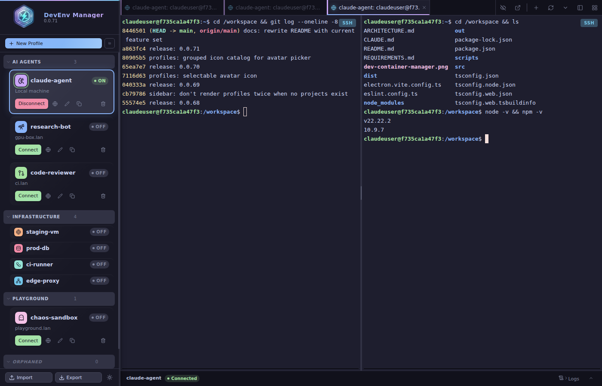

# FaKods Legendary DevContainer Manager

> **STOP. Before you open one more raw SSH session into one more anonymous Docker container — you need to see this.** The ultimate desktop command center for remote development containers: SSH tunnels, live status, split terminals, session restore, and full container control, all in one gorgeous window. It's not called *Legendary* for nothing.



---

## What is it?

Picture this: you're running AI agents inside Docker containers scattered across remote servers. You've got six SSH sessions open, you've forgotten which terminal belongs to which box, and somewhere a port forward silently died twenty minutes ago. Sound familiar? **Those days are OVER.**

FaKods Legendary DevContainer Manager is a **native Electron desktop application** that puts you in absolute command of your development environments — remote *and* local. One click connects the tunnel, starts the container, and drops you into a shell. Close the app, reopen it tomorrow, and your terminals come back like you never left. This isn't a terminal with extra steps. This is a *cockpit*.

No more juggling windows. No more squinting at `docker ps` over SSH. No more "wait, which tab was staging?" Just connect, work, and ship.

And when your agent deserves a tighter leash, switch a profile to an **NVIDIA OpenShell sandbox**: same tiles, same terminals, same port forwards, plus deny-by-default networking, filesystem policy and credentials the agent never gets to see.

---

## The Features (hold on to your keyboard)

### Profile Management — your environments, beautifully organized
- Named **connection profiles** with SSH credentials, container config, port forwards, and connection policies — everything one environment needs, in one tile
- **Projects!** Group profiles into collapsible sections, drag-and-drop profiles between them, rename and delete at will — strays are rounded up into an automatic *Orphaned* section
- **Per-project compact mode** — sidebar getting crowded? Collapse any project's tiles down to icon + name + On/Off badge with one click. Expands just as fast, and every project remembers its own setting across restarts
- **An icon catalog of ~160 hand-picked icons in 12 themed groups** — AI & Agents, Code & Dev, Infrastructure, Data, Docs, Media, Ops, Security, Business, Science, Life, even *Animals*. Give your coding agent a brain circuit, your database box a... database, and your chaos sandbox a ghost 👻
- **16 accent colors** per profile, plus auto-coloring for the undecided — tiles glow green when connected, spin while connecting
- **Import/export profiles as JSON** — ship your entire setup to a teammate in seconds
- One-click **Clone** to duplicate a profile and tweak it

### SSH + Container Lifecycle — the heavy lifting, handled
- Full **SSH tunnel management**: keepalive, identity files, custom options, automatic reconnect policies
- **Local machine mode** — one checkbox and SSH disappears entirely; manage containers right on your own machine
- **Docker container control from the UI** — Start, Stop, Restart, Recreate, Delete. No terminal gymnastics
- Auto-detects the container's default shell from its image `CMD` (yes, really)
- **Live port forward monitoring** — every tunnel shows active/inactive status in real time
- **Auto-connect on startup** — flag a profile and the app reconnects and opens a terminal before you've finished your coffee
- **Container behavior policy** per profile: attach-or-recreate, attach only, start if stopped, or scorched-earth always-recreate

### OpenShell Sandboxes — Docker's security-conscious sibling
- Pick **Environment → OpenShell sandbox** in any profile and it runs in an [NVIDIA OpenShell](https://github.com/NVIDIA/OpenShell) sandbox instead of a plain container: filesystem rules, deny-by-default network egress, secrets injected as *providers*
- Works **locally and on remote hosts** — for remote profiles the app drives the OpenShell CLI over your existing SSH settings, nothing new on your laptop
- Create, start, stop, recreate and delete from the status panel; the app recovers sandboxes that crashed or whose main process ended
- **Terminals** open their own shell in the sandbox (`exit` never takes the sandbox down); give the profile a *main command* like `claude` and the first terminal attaches to it
- **Mount a project folder**, **port forwards** into the sandbox (from remote hosts too), **file drop and image paste** into sandbox terminals
- A full **Sandbox tab** in the profile editor, with "Test connection" and providers/templates loaded straight from the gateway
- Docker profiles stay exactly as they are — mix both kinds in the same project

### Terminal — where you'll actually live (and love it)
- Full **xterm.js** terminal, Catppuccin-themed in dark *and* light
- **Session restore across restarts** — quit the app, come back, and your terminal tabs reconnect right where you left them. Witchcraft? No. Engineering
- **Split panes** — vertical or horizontal, each an independent PTY into the container
- **Tile mode** — see *all* your terminals at once in a grid
- **Detachable terminal windows** — pop any terminal out into its own window and drag it to your second monitor where it belongs
- **Hide & restore terminals** — stash noisy terminals out of view; the profile tile shows an eye badge with a count, one click brings them all back
- **Tab strip, your way** — keep tabs on top or flip to a **vertical sidebar mode** with compact chrome and context icons (local / SSH / container at a glance). Drag-and-drop tab reordering included, obviously
- **Reconnect All** button revives every exited terminal in one shot
- **Paste clipboard images and drag-drop files** — they land as paths in the shell, ready to use
- Smart **URL handling** — clickable links even when they're hard-wrapped across lines or buried inside TUI panel borders, and full login URLs survive pane resizes
- Find bar, font zoom, copy/paste shortcuts, right-click paste, 5000 lines of scrollback
- **Dynamic tab + window titles** via OSC title sequences — your tabs name themselves

### Live Status Panel — omniscience, included
- **Always-visible status strip**: profile name, SSH badge, container status, active port count
- Expandable detail panel: SSH connection info, port forward list, container image, action buttons
- **Event log** with per-level color coding, search, profile filtering, and copy-to-clipboard

### Polished UI — because you deserve nice things
- **Glassmorphism** sidebar and status cards — frosted panels, backdrop blur, the works
- **Catppuccin Mocha** dark + **Catppuccin Latte** light, switchable anytime
- Gradient buttons with shimmer hover, animated ping dots for unread terminal activity
- Green glow on connected profiles, spinning ring on connecting avatars
- Spring-animated toasts with countdown bars, and a danger-pulse confirm dialog so you never accidentally nuke the wrong container

---

## Getting Started

### Prerequisites

- Node.js 22+
- `openssh-client` (for the SSH tunnels)
- Docker on the remote host (or locally, for local machine mode)
- Optional, for sandbox profiles: [NVIDIA OpenShell](https://github.com/NVIDIA/OpenShell) **0.1.6 or newer** (CLI + gateway) on the machine that runs the sandboxes — see [OpenShell Sandboxes](#openshell-sandboxes)

### Install & Run

```bash
npm install
npm run dev
```

### Build AppImage (Linux x64)

```bash
npm run dist
# Output: dist/FaKods Legendary DevContainer Manager-<version>.AppImage
```

### Build DMG (macOS)

Run on a macOS machine with Xcode command-line tools installed:

```bash
xcode-select --install   # one-time setup
npm install
npm run dist:mac
# Output: dist/FaKods Legendary DevContainer Manager-<version>.dmg
```

Produces separate `.dmg` files for Intel (`x64`) and Apple Silicon (`arm64`).

The Linux AppImage runs on distributions with **glibc 2.34 or newer** (Ubuntu 22.04+, Debian 12+, RHEL 9+). The build checks this; see `CLAUDE.md`.

### Run a second instance with its own config

To try a build without touching the instance you work in, start it with a
separate config folder. It then has its own profiles and its own saved
terminal session:

```bash
npm run dev -- --config-dir=~/devenv-test
# or
DEVENV_CONFIG_DIR=~/devenv-test npm run dev
# or a built AppImage
"dist/FaKods Legendary DevContainer Manager-<version>.AppImage" --config-dir=~/devenv-test
```

The folder is created if it doesn't exist. Its name is shown in the window
title, e.g. `… — DevEnv Manager [devenv-test]`. Only the app's own data is
separated. Containers, sandboxes and local ports are shared with the machine,
so don't connect profiles with the same container name or ports in both
instances at the same time.

---

## Architecture

```
┌─────────────────────────────────────────────────────────┐
│  Renderer (React + TypeScript + Vite)                   │
│  ├── Sidebar        — projects, profile tiles, compact  │
│  ├── TerminalTabs   — tabs (top/side), tiles, splits    │
│  ├── TerminalView   — xterm.js panes                    │
│  ├── StatusPanel    — SSH / ports / container info      │
│  ├── LogViewer      — live event log                    │
│  └── DetachedTerminalApp — pop-out terminal windows     │
├─────────────────────────────────────────────────────────┤
│  Main Process (Electron + Node.js)                      │
│  ├── TerminalManager   — node-pty PTY sessions          │
│  ├── ConnectionManager — SSH tunnels + port forwards    │
│  │   └── OpenShellForwards — sandbox port forwards      │
│  ├── ContainerBackend  — one interface, two backends:   │
│  │   ├── ContainerManager — Docker (local / over SSH)   │
│  │   └── OpenShellBackend — sandboxes via OpenShellCli  │
│  ├── ProfileManager    — profiles + projects (JSON)     │
│  ├── SessionManager    — terminal session persistence   │
│  └── EventLogManager   — structured event logging       │
└─────────────────────────────────────────────────────────┘
```

State management: **Zustand**
Terminal emulation: **xterm.js** (FitAddon, SearchAddon, custom wrapped-link provider)
IPC: Electron contextBridge with typed API surface
Theme: **Catppuccin** Mocha / Latte

---

## Keyboard Shortcuts (Terminal)

| Shortcut | Action |
|---|---|
| `Ctrl+Shift+F` | Open find bar |
| `Ctrl+Shift+C` | Copy selection |
| `Ctrl+Shift+V` | Paste |
| `Ctrl+=` / `Ctrl++` | Increase font size |
| `Ctrl+-` | Decrease font size |
| `Ctrl+0` | Reset font size |
| `Ctrl+L` | Clear scrollback |
| Right-click | Paste from clipboard |

---

## Local Machine Mode

Profiles are SSH-first by default, but you can run everything locally — no SSH required. Perfect for managing Docker containers on the same machine as the app.

### How to enable

1. Open the **Profile Editor** → **General** tab
2. Check **Local machine (no SSH)**
3. The SSH tab disappears — it isn't needed
4. Configure your container as usual on the **Container** tab
5. Use **Port Mappings** (replaces Port Forwards) to expose container ports directly on the host

### What changes in local mode

| | SSH mode | Local mode |
|---|---|---|
| Connection | SSH tunnel to remote host | No network connection |
| Container exec | `ssh host docker exec -it` | `docker exec -it` directly |
| Port mapping | SSH `-L` forward + `-p host:container` | `-p host:container` only |
| Terminal (ssh context) | Remote SSH shell | Local shell |
| Port auto-detect | Runs via SSH | Runs locally |

The status panel shows **Local Machine** instead of SSH Connection, and the profile tile displays "Local machine" in place of the hostname.

---

## OpenShell Sandboxes

[NVIDIA OpenShell](https://github.com/NVIDIA/OpenShell) runs agents in sandboxes with a policy around them: which files they may touch, which hosts they may reach (nothing, by default) and which credentials they may use without ever seeing them. A **gateway** creates the sandboxes on Docker, Podman, MicroVMs or Kubernetes; the `openshell` CLI talks to it.

An OpenShell profile behaves like a Docker profile — tile, status panel, terminals, port forwards, session restore — but the environment is a sandbox. Tested with **OpenShell 0.1.6** (Docker driver), locally and against a remote NVIDIA DGX Spark.

### Where things have to be installed

The app never talks to a gateway over the network itself. It runs the `openshell` CLI — directly for local profiles, over SSH for remote ones (just like `docker` today).

| Profile | Runs the CLI | Install on your machine | Install on the remote host |
|---|---|---|---|
| Local | `openshell …` | OpenShell (CLI + gateway) + Docker/Podman | — |
| Remote | `ssh host openshell …` | nothing new (`ssh` as today) | OpenShell (CLI + gateway) + Docker |

### Setting up a host (local or remote)

On the machine that should run the sandboxes, as the user the app connects as:

```bash
curl -LsSf https://raw.githubusercontent.com/NVIDIA/OpenShell/main/install.sh | sh
openshell status          # should report "connected"
```

On Debian/Ubuntu the gateway runs as a **systemd user service**. On a remote host, keep it running when nobody is logged in:

```bash
sudo loginctl enable-linger $USER
```

For remote profiles, check from your machine that the app will find everything (the app uses non-interactive SSH with `BatchMode=yes`, so key login must work):

```bash
ssh -o BatchMode=yes myhost true && echo SSH OK
ssh myhost 'command -v openshell; openshell --version'   # empty? set "CLI Path" in the profile
ssh myhost openshell status -o json                       # "status": "connected"
```

### Creating a sandbox profile

1. **New Profile** → General: name, and either *Local machine* or an SSH host (SSH tab).
2. **Environment → OpenShell sandbox**.
3. **Sandbox tab** — press **Test connection** first. Then, as needed:

| Section | What it does |
|---|---|
| Sandbox | Sandbox name (lowercase, digits, single dashes, max 19 chars; stays fixed when you rename the profile), image *or* sandbox template, **main command**, restart policy, terminal shell |
| Resources | CPU, memory, GPUs |
| Workspace Folder | Mount a folder from the gateway host into the sandbox (e.g. `/home/you/project` → `/sandbox/project`) |
| Port Forwards | `localhost:<local port>` → port inside the sandbox; for remote profiles also the port used on the host |
| Environment Variables | Non-secret values only — the sandbox can read them (names like `*_TOKEN` get a warning) |
| Providers | Credentials registered on the gateway (`openshell provider create`); load the list with *Load from gateway* |
| Policy | Path to a policy YAML on the gateway host |
| Gateway | Gateway name, OpenShell workspace (a gateway namespace — usually empty, **not** a folder), CLI path, compute driver, raw driver config JSON |

Profiles can also be imported as JSON, e.g.:

```json
{
  "name": "agent-box",
  "ssh": { "host": "myhost", "forwards": [] },
  "backend": "openshell",
  "openshell": {
    "sandboxName": "agent-box",
    "workspaceMount": { "localPath": "/home/you/project", "targetPath": "/sandbox/project" },
    "forwards": [{ "localPort": 8080, "targetPort": 3000, "remotePort": 18080 }],
    "providers": ["github"]
  }
}
```

### Folder mounts need an opt-in on the gateway

Gateways refuse folder mounts by default (*"caller driver config is disabled…"* — the app tells you what to change). On the gateway host, add to `~/.config/openshell/gateway.toml` (create the file if it doesn't exist):

```toml
[openshell]
version = 2

[openshell.drivers.docker]
allow_driver_config = true
enable_bind_mounts  = true

[openshell.drivers.docker.resource_admission]
enabled = false
```

```bash
openshell-gateway config preflight --path ~/.config/openshell/gateway.toml
systemctl --user restart openshell-gateway      # running sandboxes survive this
```

Files the sandbox creates in the folder belong to uid 1000 on the host.

### How it differs from a Docker profile

| | Docker profile | OpenShell profile |
|---|---|---|
| Terminal | `docker exec` / `docker attach` (terminal mode) | `openshell sandbox exec … --tty`: every terminal is its own shell, `exit` leaves the sandbox running. With a *main command*, the first terminal attaches to it |
| Image `CMD` / `ENTRYPOINT` | Runs | Does not run — use the main command |
| Port forwards | SSH `-L` + `docker -p` | One `openshell forward service` per forward; remote: one `ssh -tt -L …` process per forward that covers both hops |
| Pause | `docker pause` | Suspend if the driver supports it — the Docker driver doesn't, so Pause **stops** the sandbox (open terminals close) |
| Delete / Recreate | Removes the container; your mounted folder stays | Deletes the sandbox — files that aren't in a mounted folder are **lost** (the app asks first) |
| File drop / image paste | `docker cp` | `openshell sandbox upload` (remote: via a temp file on the host) |
| Network | Whatever Docker allows | **Nothing** by default — package installs and API calls fail until a policy allows them |

### Security notes

- **Mounted folders bypass the filesystem policy**: the sandbox can read and change everything in them. Mount the project, never your home directory; use *Read-only* where you can.
- **Environment variables are visible** to everything in the sandbox. Put tokens and API keys into OpenShell providers instead.
- **Images** must be standard Linux images (no distroless / `FROM scratch`). Sandboxes run as a non-root user (uid 1000); the default image has no `sudo` and no network, so bake the tools you need into your own image.

### Troubleshooting

| Message | Fix |
|---|---|
| *OpenShell CLI "openshell" not found on myhost* | Install OpenShell there, or set **CLI Path** (e.g. `~/.local/bin/openshell`) |
| *No OpenShell gateway is registered* / *not reachable* | On that host: `openshell status`; `systemctl --user status openshell-gateway`; enable linger (see above) |
| *does not allow folder mounts yet* | Add the `gateway.toml` opt-in above and restart the gateway |
| *workspace name must contain only lowercase…* | You put a folder into **OpenShell Workspace** — clear it; folders go into *Workspace Folder* |
| *…has ended and OpenShell could not restart it… Use Recreate* | The sandbox's main process exited and OpenShell 0.1.6 couldn't restart it in place — press **Recreate** |
| Sandbox stuck in *starting* | Press **Recreate** (deleting works in every state) |

---

## Auto-Connect on Startup

Profiles can reconnect automatically when the app launches — resume a running container session with zero manual steps.

1. Open the **Profile Editor** → **Policy** tab
2. Check **Auto-connect on app startup**
3. Save and restart the app

On the next launch the app will:
- Open the SSH tunnel
- Apply the profile's **Container Behavior** policy (see below)
- Open a terminal session directly into the container (or SSH host if no container is configured)

And remember: even *without* auto-connect, the app restores your last open terminals on startup — auto-connect just brings the tunnel and container up with them.

### Container Behavior Policy

Controls what happens to an existing container when a profile is launched. Configurable per-profile under **Profile Editor → Policy → Existing container behavior**:

| Option | Behavior |
|---|---|
| `attach-or-recreate` | Attach if running; create/start if not. **(default)** |
| `attach` | Attach only. Fails if the container is not already running. |
| `start` | Start if stopped. Fails if the container doesn't exist. |
| `recreate` | Always remove and recreate the container from scratch. |

The same setting applies to OpenShell sandboxes. Keep in mind that recreating a sandbox loses every file in it that isn't in a mounted folder.

---

## Dynamic Terminal Titles

Tab titles and the Electron window title update automatically when the shell emits an OSC title escape sequence. To enable this, add the appropriate snippet to your shell config on the remote host:

**Bash** (`~/.bashrc`):
```bash
PROMPT_COMMAND='echo -ne "\033]0;${USER}@${HOSTNAME}:${PWD/#$HOME/~}\007"'
```

**Zsh** (`~/.zshrc`):
```zsh
precmd() { print -Pn "\e]0;%n@%m:%~\a" }
```

**Fish** (`~/.config/fish/config.fish`):
```fish
function fish_title
    echo (whoami)@(hostname):(prompt_pwd)
end
```

You can also set the title manually from any shell at any time:
```bash
echo -ne "\033]0;my custom title\007"
```

The window title format is `{tab title} — DevEnv Manager`, falling back to just `DevEnv Manager` when no terminal is open.

---

## License

MIT
